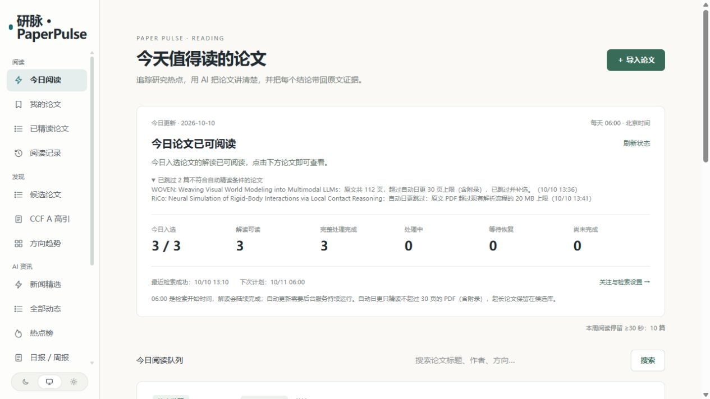

# 研脉 · PaperPulse

以论文阅读为主线的个人研究工作台：发现值得读的论文，用 AI 精读正文和关键图表，把结论带回原文证据，并保留自己的笔记。也可启用 AI 新闻采集、中文摘要、热点与日报。

**当前定位：单人本地工作空间。** 已验证真实论文及新闻流程；多用户服务、公开部署和自动代码复现尚未完成。模型核查是辅助工具，不能保证所有结论正确。

## 功能

| 功能 | 当前能力 |
| --- | --- |
| 论文发现 | arXiv 热点与八个预设方向；细分主题、重点关注、补充词和排除词；候选分类及命中解释 |
| 今日阅读 | 北京时间 06:00 开始，默认最多三篇；方向独立恢复与重复调度去重；PDF 最多 30 页（含附录），超长自动补位 |
| 高引与经典论文 | OpenAlex 引用数据与部分计算机 CCF A venue 白名单；年份、方向、会议/期刊筛选，显式选择后才精读 |
| 我的论文 | arXiv、DOI 与本地 PDF 导入；首页身份核对、同篇去重、多份原文版本、个人标签及状态 |
| AI 精读 | 正文覆盖检查 → Skill 精读 → 原文逐条核查 → 关键图表解释；覆盖问题、方法、实验和局限 |
| 视觉图表 | 从真实 PDF 裁切最多六张图表，模型接收原图；区分图像观察、文字补充与不确定内容，独立核查后发布 |
| 原文阅读 | PDF.js 连续滚动；解读引用回跳证据段落并黄色高亮，无法精确定位时明确提示 |
| 阅读笔记 | 整篇、段落及图表笔记；自动保存、草稿恢复、修订冲突处理；重读不覆盖个人文字，支持 Markdown 导出接口 |
| 恢复与评测 | 保存阶段、运行编号、回执及核查问题；定位、局部修订与继续；执行统计及独立模型质量评测 |
| AI 资讯 | 底座的采集、双次评分、中文摘要、事件归组、热点、日报、RSS、API 与 MCP；Jina 密钥优先，缺密钥或明确认证/余额不足时匿名读取 |

正文超限会停止，不静默裁剪。候选库不会批量购买精读；打开页面只读取数据，模型与解析请求在后台执行。

## 页面预览

以下为本机真实运行截图，展示内容不会随克隆导入数据库。

**今日阅读：入选、可读、完整完成和等待分别展示。**



**AI 新闻：中文标题、摘要、评分与推荐理由。**


## 技术结构

- **前端**：React Router SSR、TypeScript、PDF.js，仅通过 HTTP 访问后端。
- **后端**：Node.js 24 直接运行 TypeScript、Fastify、PostgreSQL、pg-boss 持久化任务。
- **材料与模型**：MinerU API 解析 PDF；OpenAI 兼容模型接口；视觉请求接收本地裁切原图。
- **证据与恢复**：PDF 哈希、原文版本、证据块、模型回执及运行事件共同绑定文章；失败不覆盖旧的可读解读。


| 目录 | 职责 |
| --- | --- |
| `modules/papers/` | 论文业务、API、页面、迁移、Skill、精读和评测测试 |
| `apps/api/` / `apps/worker/` / `apps/web/` | HTTP API、后台任务和网页 |
| `packages/backend/` | 共用模型、回执、预算、新闻与公开读取层 |
| `industry/` / `site/` | 新闻分类、来源、提示词、模型、品牌与文案 |
| `docs/evidence/` | 按日期保留的验证结果与限制，不含原始 PDF、模型回答或私人笔记 |

## Windows 本地运行

需要 **Node.js 24.11+、npm、Docker Desktop**，Docker 用于独立 PostgreSQL 容器。

```powershell
npm ci
npm run local:setup
npm run build -w @aihot/web
npm run local:start
```

新配置默认访问 **http://127.0.0.1:5320**，API 为 `4321`，数据库为 `5545`。端口可在 `.env` 中修改，已有环境以实际配置为准。`local:setup` 不覆盖已有配置或删除数据库。

```powershell
npm run local:stop
# 重启前确认没有执行中的解析、模型和采集任务
powershell -ExecutionPolicy Bypass -File scripts/local.ps1 restart
```

首次运行会生成本机 `.env`、`.env.test` 和数据库配置，全部被 Git 忽略。**仓库不包含本机密钥、论文 PDF、笔记或数据库，每台机器独立配置。**

### 启用真实精读

在后端 `.env` 配置 `LLM_BASE_URL`、`LLM_API_KEY`、`LLM_MODEL`，显式开启 `MODEL_CALLS_ENABLED=true`。需要正式 PDF 解析时配置 `MINERU_API_TOKEN`、开启 `MINERU_CALLS_ENABLED=true`，并在后台 `/admin/settings` 为 `mineru` 设置非零请求额度。

模型实际支持图片时才开启 `LLM_VISION=true`；否则使用明确标记的文本图表解释。没有 MinerU 时，arXiv 可使用注明来源的 HTML 轻量解析，不能称为完整 PDF 解析。

本地开发身份只用于回环地址。公开部署前须关闭 `DEV_AUTH_*`、配置管理员登录与 HTTPS，验证私人论文和笔记访问边界。详细设置见 [运行指南](docs/paperpulse/getting-started.md) 与 [部署说明](docs/deploy.md)。

## 验证与限制

```powershell
npm run typecheck
node --env-file=.env.test --test-global-setup=tests/databases.ts --import ./tests/databases.ts --test modules/papers/tests/*.test.ts
npm run build -w @aihot/web
node --test apps/web/tests/*.test.ts
node scripts/smoke.ts --base http://127.0.0.1:5320
```

完整后端测试必须指向名称以 `_test` 或 `_ci` 结尾的独立数据库，不能使用真实论文库。测试供应商请求仅连接本地假服务。

本机最近相关回归 **195/195 通过**，类型检查、Web 构建及服务冒烟通过。Windows 全量套件仍有 SIGTERM、缺少 PostgreSQL 备份工具／shell、OpenSSL 配置、测试库冲突和缺少 Playwright 浏览器等失败；**不声明全量测试通过**。GitHub Actions 的 Linux 结果以该仓库实际运行结果为准。

- CCF A venue 白名单不完整；高引用不直接证明经典价值，venue 匹配也不等于单篇 Full/Regular paper 已核验。
- PDF 当前最多 20 MB；自动日更最多 30 页，手动精读仍受正文容量约束，任意超长论文分段精读尚未实现。
- MinerU 中间批次未完整持久化，请求结果未知时不能保证立即取回。
- 视觉核查仅覆盖最多六张已选原图，不等于全文视觉验证；独立核查可能共用同一模型。
- 尚未完成论文对话、个人推荐记忆、PDF 持久划线、多用户协作及自动代码复现。

真实记录：[每日阅读恢复](docs/evidence/2026-10-10-daily-length-and-mineru-recovery.md)、[Jina 与新闻恢复](docs/evidence/2026-10-10-jina-key-anonymous-fallback.md)、[精读评测](docs/evidence/2026-10-10-reading-evaluation.md)。原始运行产物留在本机。

## 来源、贡献与许可

基于 [KKKKhazix/AIHOT](https://github.com/KKKKhazix/AIHOT)，保留 Git 历史，底座起点 `ede7c7bf6fbf2fe3d1282732423f16d1fc7dbf08`。使用自有站名与品牌，不以 AIHOT 名义发布。

| 范围 | 来源 |
| --- | --- |
| 新闻采集、评分、归组、日报、公开 API/RSS/MCP、基本框架 | 复用上游，不能算作本项目从零实现 |
| 论文发现、导入、原文版本、证据精读、视觉图表、PDF 回跳、笔记与论文评测 | 本项目新增，主要集中在 `modules/papers/` |
| 共用模型诊断、视觉输入及 Jina 匿名读取适配 | 本项目对底座的扩展与修正 |
| 论文阅读 Skill | 使用 [techdou/paper-reading](https://github.com/techdou/paper-reading) 核心规则子集，宿主增加输出结构和引用校验；Apache-2.0 LICENSE、NOTICE 与来源保留在模块内 |

代码遵循上游 [MIT License](LICENSE)，第三方材料另遵其许可，见 [NOTICE](NOTICE)。新闻与论文原文属于各自作者或发布方，默认仅展示新闻摘要与原文链接。

更多细节：[模块实现记录](docs/paperpulse/implementation-notes.md)、[底座架构](docs/architecture.md)、[上游原始 README](docs/paperpulse/AIHOT-UPSTREAM-README.md)。
