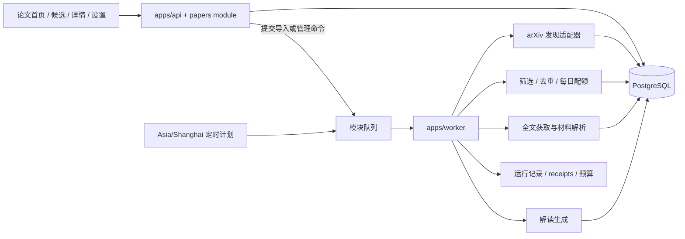

# 论文热点与阅读系统设计计划

- 日期：2026-10-06
- 状态：讨论基线；阶段 0 与阶段 1 的首批代码已落地，真实 arXiv 部署验收和历史版本保留仍待完成
- 范围：在 PaperPulse / AIHOT 底座上建设计算机方向论文发现、筛选、解读和阅读跟踪能力

## 1. 目标与产品边界

把已有的行业信息处理底座用于论文内容，做成一个每天可用的个人论文阅读入口：从值得关注的热点方向和个人关注方向中发现候选论文，说明入选原因，自动准备少量论文解读，并帮助使用者把候选转成实际阅读。

首期聚焦计算机方向，优先关注 RAG 与检索、多模态、大模型推荐。产品读者看到的内容以论文为中心。AIHOT 已经具备的热点新闻产品能力不浪费：复用其信源接入、调度、筛选、排序、主题/报告、任务运行记录和运营界面等成熟机制；但首期不在论文阅读界面混入 AI 新闻，不把新闻事件直接当成论文，也不照搬新闻热度的时间窗口和评分公式。

首期服务单人、自用和作品集展示，不做多租户论文社区、公开投稿、社交讨论或通用研究 Agent。核心闭环是“发现候选 → 解释为什么推荐 → 读论文/看解读 → 形成轻量阅读记录”。完整文献综述、研究问题工作台、实验规划和自动生成研究结论都不属于当前版本。

## 2. 参考产品带来的设计约束

- [论文精读目录](https://liuzhao09.github.io/papers.html)体现了适合高频浏览的精读档案：按来源/机构、模型名和一句话介绍快速定位，列表信息密度较高。可借鉴其可扫描、可搜索、便于回看的目录表达；当前观察只基于目录页，不假设其单篇页面的未核实交互。
- [alphaXiv 首页](https://www.alphaxiv.org/)把“值得读什么”与研究者、机构等发现入口连接起来；[单篇论文页示例](https://www.alphaxiv.org/abs/2610.06851)呈现论文元数据、摘要、带页码线索的 AI 解读、图表、局限、相似论文等。首期借鉴“发现理由与论文详情相连”“解读可以回到原文定位”的思路，不复制其社区、音频、社交等完整功能面。

因此首期采用两层体验：候选/今日阅读列表用于快速判断；论文详情页保留原文、结构化解读和可核对的证据定位。论文数量少而稳定优先于列表看起来很满。

## 3. 当前代码基线与设计含义

以下是当前仓库检查到的实现事实，后续实施前仍需在对应代码和部署配置上复核：

- 根路径已由 `modules/papers/web/home.tsx` 提供论文首页；`/news/featured` 等新闻页面仍在路由中。后续应让主要导航和首页围绕论文工作流组织，不应误判为需要重建论文首页。
- `modules/papers` 有论文列表、详情、PDF/材料与解读对象；新增迁移增加了稳定 arXiv ID、发现计划、候选、每日队列和趋势快照。论文表仍只保存当前版本；检测到新版本时会清理旧 PDF/材料/解读并重新入队，不保留历史版本内容。
- 材料解析与解读的手动操作、导入后解析以及自动发现选中的论文都通过模块队列交给 worker；API 只排队并返回状态。队列支持持久化重试，单论文任务通过 singleton key 去重。
- 自动发现已接入每日 06:00（Asia/Shanghai）计划，但默认受 `PAPER_DISCOVERY_ENABLED` 关闭。arXiv 结果按计划和 ID 去重；每日配额最多 3 篇、热点最多 1 篇。前 7 天对比数据来自 arXiv API 的检索总数，不代表领域重要性。
- MinerU 现在通过 receipts 记录完整请求结果，服务预算缺失时自动建立为零预算，并由 `MINERU_CALLS_ENABLED` 安全阀控制；要启用还需在后台显式设置 `mineru` 预算。MinerU 以外的真实 API 调用仍未做生产环境验收。
- OpenAlex CCF A 参考检索已实现为独立周任务与页面：首期白名单聚焦已选研究方向，只存储与 CCF A venue 名称匹配、且 OpenAlex 有正引用数的结果，不占每日三篇阅读队列；`PAPER_OPENALEX_ENABLED` 默认关闭，API key 可选且只由后端读取。首期白名单不是完整 CCF A 目录，venue 等级也不能证明单篇论文的 Full/Regular 发表类型。
- 新闻趋势当前基于新闻事件和短时间热度衰减。论文趋势应从论文来源数据独立计算，不能直接复用新闻事件分数。

本方案遵循项目架构边界：web 只经 HTTP 调 API；DB、密钥和模型调用留在后端；模型任务进 worker；公开输出若未来增加，应通过统一 publication 层。首期个人阅读入口是否需要公开，由单人私有部署边界决定，不新建公开出口。

## 4. 用户流程与页面结构

### 4.1 主要页面

1. **今日阅读**（首页）：最多展示当日已准备好的三篇论文，标注“热点发现”或个人关注方向、推荐原因、方向/分类、发布日期、解读状态和原文入口。达到上限时不再为填满而选低质量论文。
2. **候选论文**：展示最近 7 天发现但尚未进入今日阅读的候选；可看候选来源计划、相关关键词/分类、匹配证据和筛选状态。候选过期仅表示不再自动入选，不删除论文记录。
3. **论文详情**：元数据、摘要、原文 PDF/公开 HTML、AI 解读、方法/结果/局限等结构化栏目；解读证据应带原文页码或稳定定位符，无法定位的内容明确标记为摘要性概述，不伪装成原文证据。
4. **趋势**：首期展示预定义方向/关键词组的 arXiv 论文数量变化，以及与前一周期的比较；标明数据窗口和来源。数据不足、缺失或冷启动时直接呈现，不生成确定性结论。
5. **设置**：可启停热点发现计划和个人关注计划，编辑方向关键词/分类、每日总量上限（默认 3）及热点名额上限（默认 1）。首期不做复杂的任意布尔查询构造器。

### 4.2 每日选择规则

- 每日最多完成 3 篇全文解读，热点发现计划最多占 1 个名额；所有计划共享此全局上限。
- 其余名额按个人方向匹配度与新鲜度排序。多个计划命中同一篇时只保留一个候选，保留多个命中理由。
- 论文不足或质量不足时允许少于 3 篇。选择规则和入选原因可审计，不能把模型的无依据“重要性”当作事实。
- 候选有效窗口为发现后 7 天。计数基于完成解读的论文，不把发现条目或失败任务计入每日完成量。

## 5. 信息来源与发现逻辑

### 首期来源

首期仅接入 arXiv 元数据和公开论文全文。分类与关键词计划负责发现；只对可公开访问的 arXiv HTML/PDF 做自动全文解析，不爬取出版社付费全文。论文仍保留 arXiv 原文链接、来源标识及版本信息。

### 计划类型

- **热点方向计划**：覆盖更广的 AI/ML 预定义分类和关键词组，输出方向级趋势和少量热点候选。第一版由人工维护方向定义，不先做模型自动聚类。
- **个人关注计划**：RAG 与检索、多模态、大模型推荐三个独立计划，可分别启停和调整分类/关键词。某个候选可同时命中多个个人方向。

### 热点证据

第一版热点信号采用可解释的计数：按来源、分类或预定义关键词组统计最近 7 天新论文量，并与前一 7 天基线比较。保留抓取时间、窗口、分类/关键词映射和原始计数。缺数据、映射冲突和新方向冷启动需单独显示；不把引用量缺失当作零，也不由 LLM 生成趋势数字。首期暂不引入自动聚类、复杂热度模型和跨站引用量。

## 6. 领域对象与状态

核心概念建议保持在论文模块内，不把论文塞进新闻 Article/Story/Event 数据结构：

- **DiscoveryPlan**：计划类型、名称、来源、分类/关键词、启用状态和配置版本。
- **PaperIdentity**：跨版本稳定身份，首期以规范化 arXiv ID 去重；为后续 DOI/出版版本关联留出明确边界。
- **PaperVersion**：论文某个具体版本的元数据、公开全文地址、文件哈希和发布日期。解析材料与 AI 解读关联到版本及输入哈希，避免论文更新后仍展示旧版本解读。
- **Candidate**：某计划在某次运行中发现/命中的论文，记录计划、命中原因、发现时间、筛选分数/特征和候选状态。同一篇论文可以有关联的多个计划命中。
- **PaperMaterial / Digest**：保留现有材料与解读数据概念，补足版本关联、任务状态、提示词/模型版本、证据定位及失败信息。
- **DiscoveryRun / AnalysisRun**：记录时间窗口、来源响应、处理数、去重数、失败数、预算/receipt 关联和运行结果，支持审计和补跑。
- **ReadingSignal**：阅读页可见时间达到 30 秒时记录一次轻量阅读信号。仅统计页面前台且文档区域可见的时间；同一篇按版本/本地用户去重。它只是阅读代理指标，不等同于真实读完。

论文处理状态建议覆盖：`discovered → candidate → selected → material_pending → digest_pending → ready`，以及 `filtered / unavailable / failed / expired` 等终态/旁路状态。任务状态与用户的阅读进度分开保存，重试不重置阅读记录。

新增表结构放在新的模块迁移文件，已发布迁移不修改。自 `0055` 起每个迁移文件只包含一条允许在线执行的语句；索引使用并发创建。具体字段和迁移拆分在核对当前 schema 与升级路径后定稿。

## 7. 服务与任务架构

- **API 模块**负责认证、配置读写、候选/论文读取、显式用户动作和入队；不能直接等待长时间全文解析/模型生成。
- **计划任务**按 Asia/Shanghai 日历日启动热点与个人计划，写入可追踪的 run，再把每个发现/处理步骤提交到论文模块队列。时间窗口和幂等键显式保存。
- **Worker 队列**负责 arXiv 拉取、身份规范化、去重、候选筛选、每日名额协调、全文获取、材料解析和解读。每一步可重试，且以论文身份 + 版本/文件哈希 + 配置/提示词版本防止重复付费与过期结果覆盖。
- **模型与付费服务**通过平台规定的 receipts 和预算熔断机制调用；MinerU 的计费路径需审计后纳入，不能用 API fire-and-forget 规避追踪。开发和测试环境的外部调用开关保持关闭，并使用本地假服务。
- **公共发布层**：首期不新增 RSS/API/MCP 公开论文出口。以后若开放，统一通过 publication 读取层、保留来源署名/链接和全文许可边界。

## 8. 阅读信号与隐私

达到 30 秒的信号仅在论文详情页可见、页面处于前台时累计；跨短暂切页/失焦需暂停，页面关闭前尽量本地缓冲。首期建议只在本地浏览器保存去重信号及周计数，界面用不抢眼的本周阅读数展示，不弹计时器或提示。它不自动把论文标成“已读”，也不用于公开排行榜或个人画像。若之后需要跨设备汇总，再评估最小化服务端记录及隐私说明。

## 9. 分阶段计划与验收

### 阶段 0：自动任务基础整改（核心路径已实现，待部署验收）

把论文创建后的进程内解析和详情页触发的长任务收敛到 worker 队列；补齐可重入、幂等、失败可见、显式重试及 run 记录；审计 MinerU 与模型 provider 的 receipt、预算和环境开关边界。

**验收**：API 请求只创建/入队并快速返回；重启 worker 后任务仍可恢复；同一版本重复执行不产生重复解读或重复付费；失败有可读状态；测试不访问真实外部服务。

### 阶段 1：arXiv 发现与个人阅读闭环（首批功能已实现，历史版本与真实来源抽检待补）

实现热点计划和三个个人关注计划、最近 7 天候选、去重后的每日最多 3 篇、热点最多 1 篇、候选解释、论文版本关联、趋势计数、设置页面及本地低干扰阅读信号。阅读信号在论文详情页可见且浏览器前台累计达到 30 秒后按论文/周去重；每日 3 篇是上限而非填充目标。

**验收**：计划配置可持久化；相同 arXiv 论文不会重复占用名额；版本更新能使过期材料/解读失效或归档；UI 可区分来源计划与推荐理由；趋势数字可追溯到窗口和来源；页面阅读不触发模型调用。

### 阶段 2：真实使用评估与质量校准

连续使用一段时间，检查候选相关性、材料覆盖率、解读证据准确性、任务成本、失败率及阅读代理指标。目标门槛：每周至少 3 篇论文的可见阅读信号达到 30 秒；这是产品早期使用目标，不代表真实读完或研究产出。低质量推荐允许空缺；基于使用者标注样本调整筛选，而不是凭感觉改分数。

**验收**：能从 run、候选、版本、材料和解读还原一篇论文为何被发现/入选；每周复盘可以区分数据缺失、筛选错误、解析失败和解读问题；阅读信号对用户足够低干扰。

### 阶段 3：引用/期刊等来源扩展（首个来源已接入，待真实数据校验）

已接入 OpenAlex 周检索：对四个已确认关注方向检索近十年候选，按 OpenAlex 收录的正引用数排序，仅显示对应 CCF 推荐目录 A 类的 venue 名单，覆盖人工智能、数据库/数据挖掘/内容检索、计算机图形学与多媒体、交叉/综合/新兴。保存 venue、年份、引用数、OpenAlex 记录地址和抓取时间；页面说明引用覆盖边界，不把 venue 匹配说成单篇论文的 CCF 正式收录证明。

**尚待验收**：OpenAlex 查询结果与 CCF A venue 的匹配召回、引用计数与 DOI 版本关联、真实外部运行和实际白名单精确度。暂不加第二个引用数据库，也不做引用量跨源对比。

## 10. 验证策略

功能实现后按仓库要求运行 `npm run typecheck`、数据库测试、web build 与 web tests；启动站点后执行 smoke。重点增加或覆盖以下行为：arXiv 身份/版本归一化、计划重叠去重、每日配额、候选 7 天窗口、热门计数窗口、版本变更后的材料失效、队列重试幂等、前台可见阅读信号、API 不直接调用模型、外部网络被假服务隔离。样式微调不另造无价值测试。

每个阶段的验收记录需区分：已实现、自动化测试通过、真实来源验证、真实模型结果抽检、尚未验证。静态页面或 mock 数据不能宣称完成端到端自动发现。

## 11. 主要风险与处理

| 风险 | 影响 | 设计控制 |
|---|---|---|
| API 路径直接运行长任务 | 请求超时、重启丢任务、模型边界违例 | 统一入队，由 worker 执行并记录 run |
| arXiv 版本更新 | 旧 PDF/解读与当前元数据错配 | 稳定论文身份与不可变版本分开建模，哈希关联材料/解读 |
| 热点指标伪精确 | 用户把计数误读为领域重要性 | 显示窗口、来源和计数定义；缺数据显式呈现 |
| 低质量候选填满每日配额 | 降低信任和阅读意愿 | 上限而非目标；允许空位；记录筛选理由 |
| 解读无法核对 | 错误摘要被当成论文结论 | 页码/定位证据、原文链接、未定位声明、抽样人工审核 |
| PDF/模型服务成本失控 | 自动流程产生不可预期费用 | 全局每日上限、receipt、预算熔断、按版本幂等、开发禁用外部服务 |
| 新闻机制迁移过度 | 论文被不合适的事件热度逻辑扭曲 | 重用基础设施，论文身份、趋势和阅读状态单独建模 |

## 12. 明确暂不做

- 不把 AI 热点新闻作为论文卡片旁的相关内容或单独的信息流；新闻侧已有能力作为底座和未来可选产品能力保留。
- 不做多用户关注关系、评论、点赞、排行榜、公开社区或论文全文再发布。
- 不做自动主题聚类、通用自然语言检索构造器、全量引用图或复杂推荐模型。
- 不根据 30 秒停留自动判定读完，不把阅读代理数据包装成真实阅读完成率。
- 不宣称当前 OpenAlex + CCF A 结果覆盖所有高引用论文或 venue；它只是按现有查询词匹配到的数据子集。

## 13. 下一步执行顺序

1. 完成 worker 与 MinerU 回执/预算边界的代码验收，并确认开发环境的自动发现、MinerU 和模型调用安全阀均保持关闭。
2. 在明确启用部署配置后，用真实 arXiv 样本验收搜索语法、结果总数、版本去重、推荐理由、全文解析和证据解读。
3. 决定是否为 arXiv 增加不可变历史版本实体，并用真实浏览器验收 30 秒前台阅读信号。
4. 连续使用并记录相关性、解析率、解读证据准确性、成本和每周阅读代理指标。
5. 对 OpenAlex/CCF A 交叉候选做真实样本抽检，并决定是否需要 DOI/正式出版版本关联和第二数据源。
